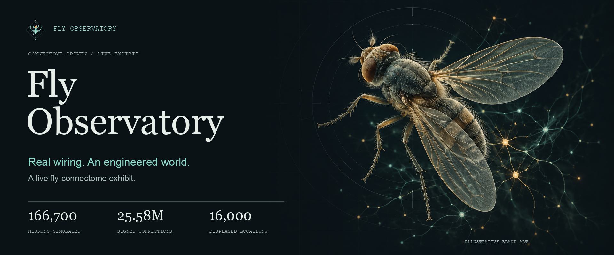

# Fly Observatory

**Real wiring. An engineered world.**

A live, non-racing showcase: a detailed procedural 3D fly seeks or avoids a light
using a full signed connectome reservoir and a trained linear steering decoder.
Switch to Brain view to inspect measured spikes at real recorded cell coordinates.

[Launch](#launch-on-this-mac) · [Views](#three-ways-to-watch) · [How it works](#how-it-works) ·
[Field simulations](#field-simulations) · [Scientific boundaries](#scientific-boundaries)

## Three ways to watch

**Concept illustrations, not app screenshots.** These images introduce the
exhibit's views in the same visual style as the banner. They are not anatomical
references or recordings of neural activity; the app's actual rendering differs.

| Habitat | Macro | Brain |
| --- | --- | --- |
| 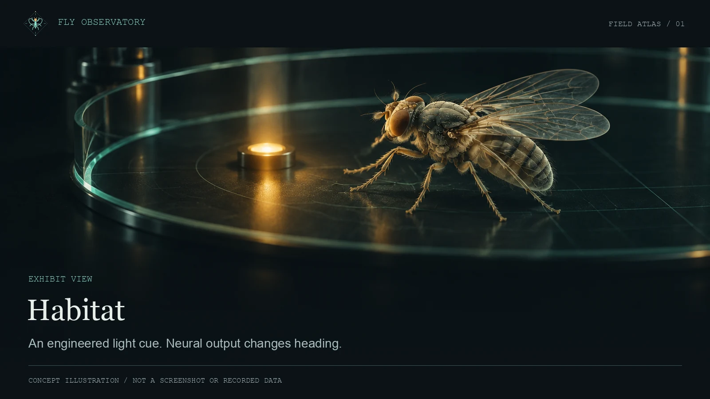 | 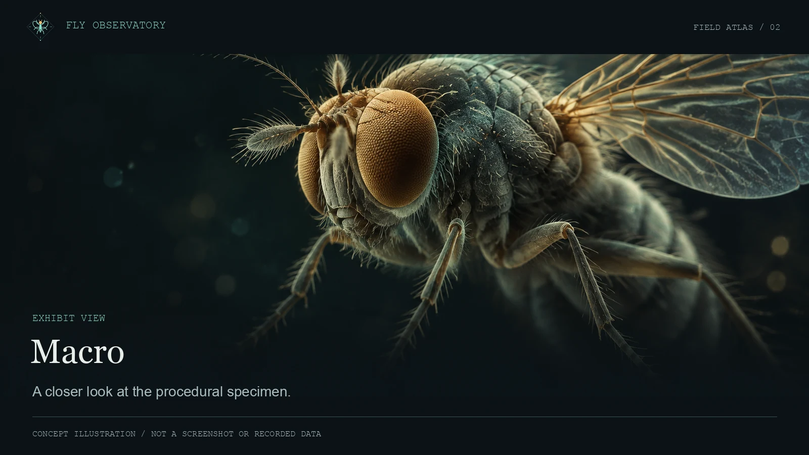 | 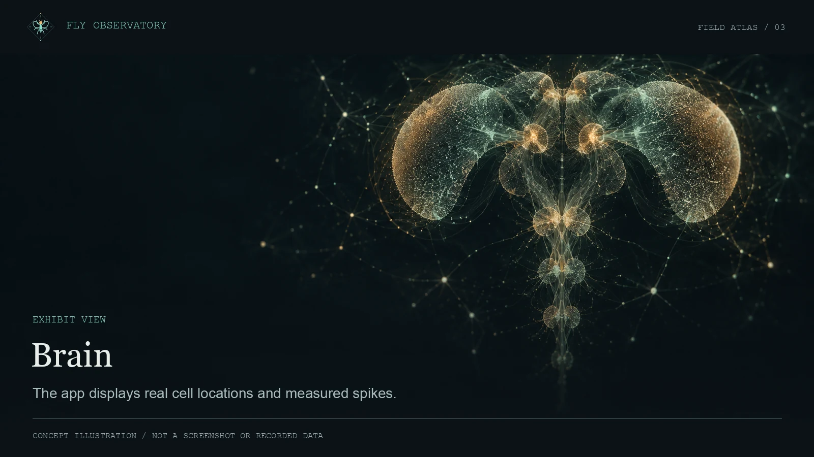 |
| Follow an engineered light cue. Neural output changes heading. | Inspect the procedural body, gait, eyes, wings, and bristles. | Inspect measured spikes at 16,000 sampled real cell locations. |

## How it works

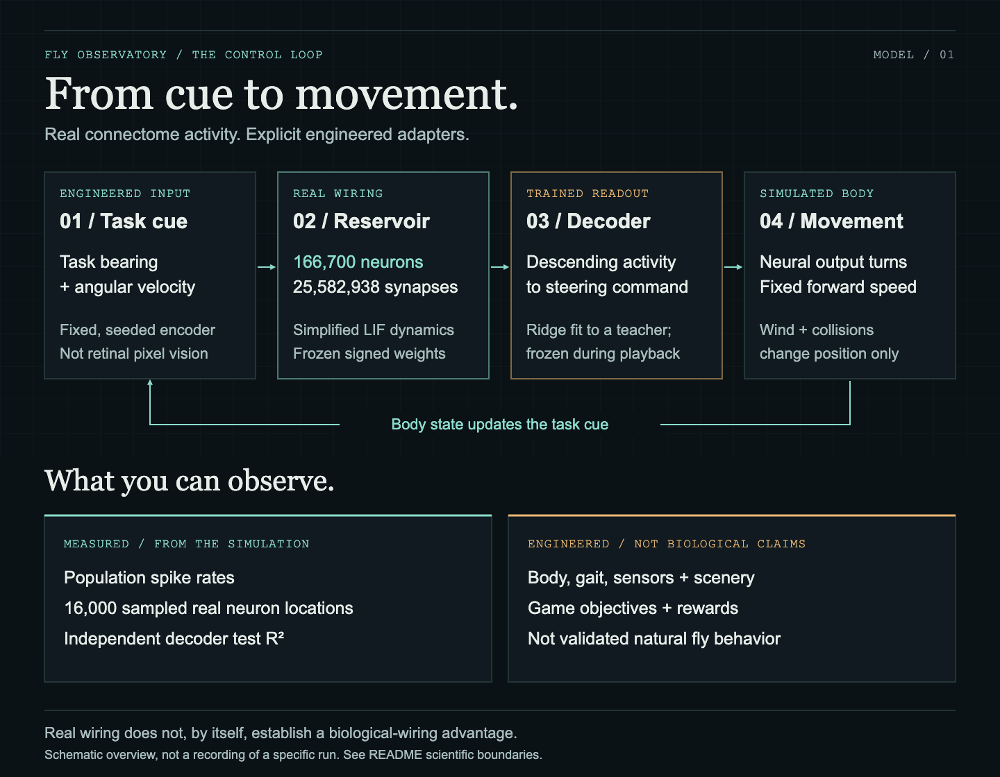

1. **Encode a task cue.** Task bearing and angular velocity enter a fixed, seeded encoder.
2. **Run the real wiring.** A simplified LIF reservoir simulates 166,700 neurons
   and 25,582,938 signed connections. Its weights stay frozen.
3. **Read out neural activity.** A ridge decoder, fitted to an engineered teacher,
   turns descending-neuron activity into a steering command.
4. **Move an engineered body.** Neural output changes heading; speed, collision
   rules, scenery, and task sensors are explicit adapters.

This is a connectome-driven exhibit, **not a validated model of natural fly
behavior**. The banner is illustrative art, not a microscope image or a recording
of neural activity. See [Scientific boundaries](#scientific-boundaries).

## Unattended livestream

**Capture URL: `http://127.0.0.1:8932/stream`**

The server starts in auto-director mode by default. A repeating sixteen-chapter
program moves between Habitat, Macro, and Brain views, changes targets, reverses
the task, and shows matched brain-off / brain-on trials. It runs with no viewers
and does not restart when a browser source reconnects. One numerical clock owns
the experiment; its 290-second cycle can take longer in wall-clock time.

The broadcast layout has readable captions, slowly directed cameras, a chapter
list, measured telemetry, and always-visible scientific boundaries. Broadcast
rendering is capped at 30 FPS. There is no generated voice or background music.
Trial resets are labeled. No choreography or direct controller steers the fly.

In OBS, add a **Browser Source** with the capture URL, **1920 × 1080**, **30 FPS**.
Use hardware acceleration. If your OBS browser cannot render WebGL2, use a normal
Chrome window and a Window Capture instead. Publishing the stream remains your
choice; the exhibit does not access OBS, accounts, or streaming services.

- **Space:** pause/resume, including the automatic program clock.
- **D:** start/stop the auto director.
- **Escape:** return to the interactive page.
- Move the pointer to reveal operator controls; they disappear when idle.
- Manual target, task, or brain-output changes take over from the director.
- **Restart** rewinds the program without reloading or retraining the connectome.

### Automatic Mac startup and recovery

```sh
cd ~/fly-showcase
~/jevlike/.venv/bin/python service.py install
~/jevlike/.venv/bin/python service.py status
```

The per-user LaunchAgent starts at login and restarts the backend after an exit
or a fatal simulation error. Restarts reload and recalibrate the real network,
usually taking 30–60 seconds. The broadcast clearly shows loading/reconnecting
rather than pretending old data is live. This is recovery, not zero downtime.

```sh
# Stop for this login session:
~/jevlike/.venv/bin/python service.py stop
# Stop and disable future automatic login startup:
~/jevlike/.venv/bin/python service.py disable
# Re-enable and start:
~/jevlike/.venv/bin/python service.py start
```

Service logs live in `artifacts/service.out.log` and `artifacts/service.err.log`.
The service uses a process-scoped `caffeinate -i` idle-sleep assertion while it
runs; stopping it releases the assertion. Global sleep settings are unchanged.
Keep the Mac on power with its lid open, and keep the T7 Shield drive containing
`~/fly-data` mounted and readable. This does not prevent manual sleep, shutdown,
or a closed-lid sleep. The helper does not launch OBS.
Do not run a second `run.sh` instance while the managed service owns port 8932.

## Launch on this Mac

```sh
cd ~/fly-showcase
sh run.sh
# Open http://127.0.0.1:8932
```

The launcher can reuse `~/jevlike/.venv/bin/python`. Loading and calibrating the
real 166,700-neuron / 25,582,938-connection network takes roughly 30–60 seconds
on Apple Silicon. There is no fake activity or fallback controller.

For a new machine:

```sh
python3.12 -m venv .venv
.venv/bin/pip install -r requirements.txt
npm install
npm run build
FLY_PYTHON="$PWD/.venv/bin/python" FLY_DATA_DIR=/path/to/fly-data sh run.sh
```

Data must contain `brain.npz` and `weights.npz` in the existing MaleCNS format.
CPU runs are supported but much slower. Runtime is loopback-only.

### Data and licensing

The external connectome dataset is **not included**. Provide your own local
`brain.npz` and `weights.npz` through `FLY_DATA_DIR`, and check the original
dataset's attribution and redistribution terms before sharing any data.
Code and dataset licensing are separate questions.

No software license has been selected for this repository. Public visibility
does not grant a general license to reuse, modify, or redistribute its code.

## Controls

- Click the habitat floor, use **Move light**, or press arrow keys to set the target.
- **Seek / Evade** changes the task bearing; the brain and decoder remain frozen.
- **Moving target** makes the light follow a slow path.
- **Brain output off** stops neural steering and clears residual turn velocity.
  Fixed forward speed remains; the fly cannot turn toward the target.
- **Pause / Restart** controls the shared exhibit. All viewers see the same run.
- **Habitat / Macro / Brain** take over from the director and change the view;
  they never directly steer the fly. Drag and scroll adjust the camera.
  Macro follows the fly for a close look at compound eyes, veins, bristles, and gait.
- **F** hides the surrounding page for a presentation.

## Field simulations

The interactive page's **Field simulation** selector starts any world instantly,
without retraining. Selection takes over from the director. **D** or **Auto
director** restores the repeating broadcast. Refresh an existing OBS browser
source after installing an updated frontend.

The gallery below is **illustrative concept art**, not screenshots or evidence
of natural fly behavior. Plumes, waypoint trails, and threat lighting are visual
metaphors for engineered adapters. The real simulation uses procedural 3D scenes.

| Windfall orchard | Follow the scent |
| --- | --- |
| 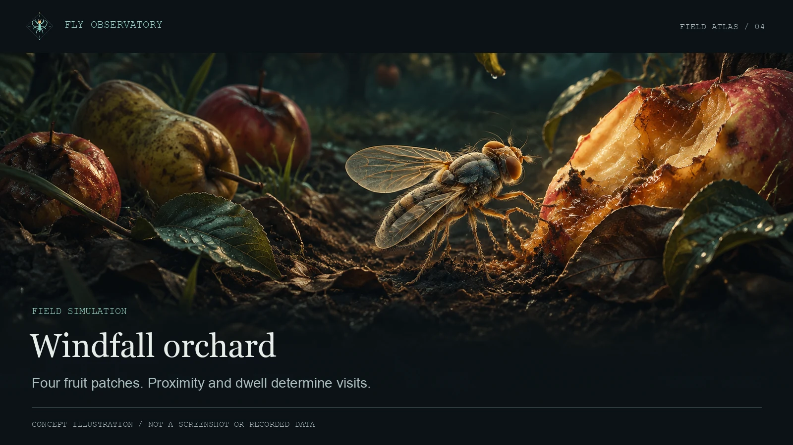 | 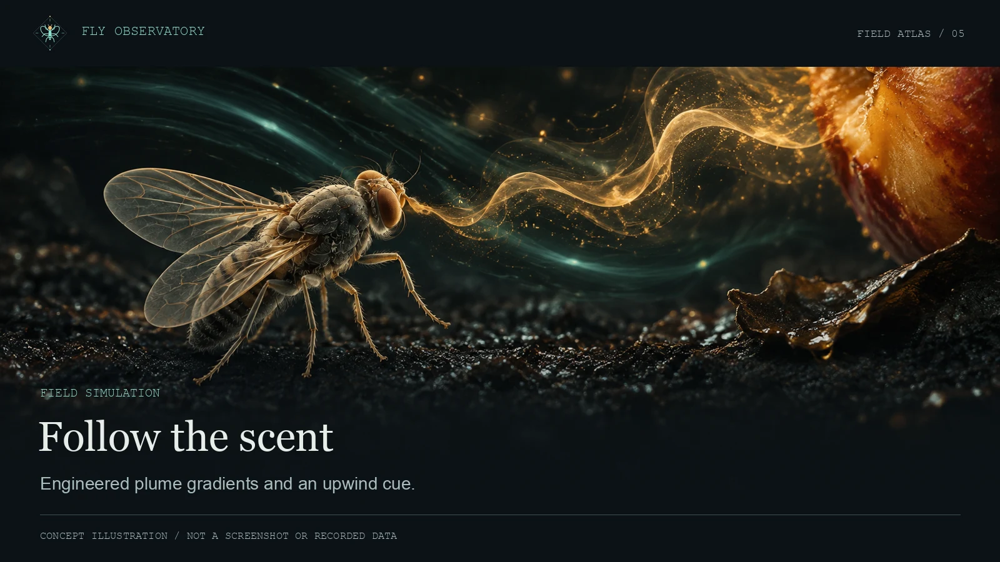 |
| **Spider escape** | **Dangerous picnic** |
| 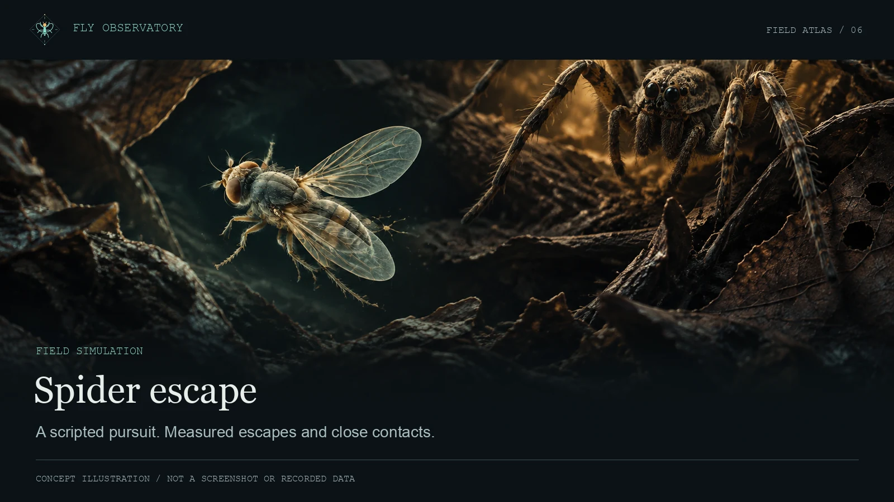 | 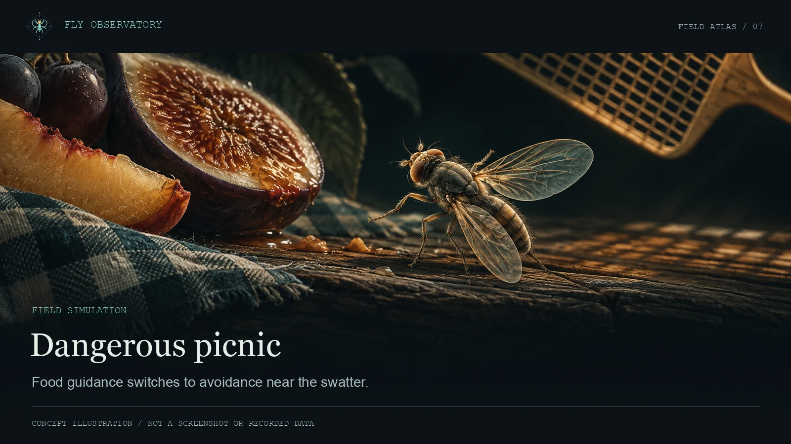 |
| **Between the stones** | **Weather the gusts** |
| 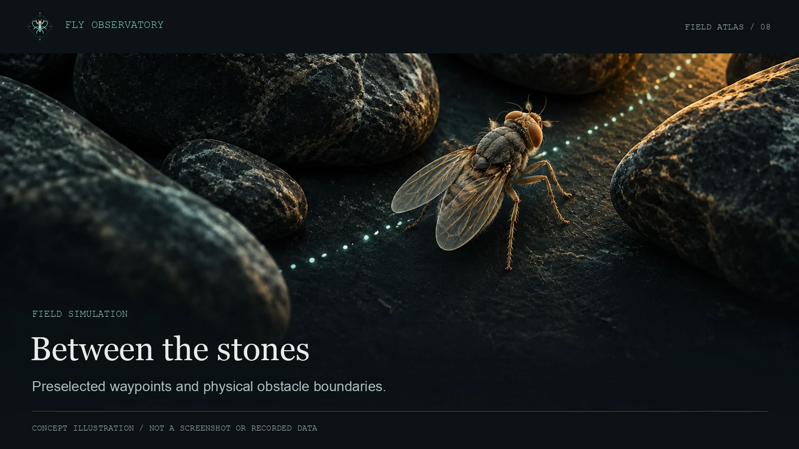 | 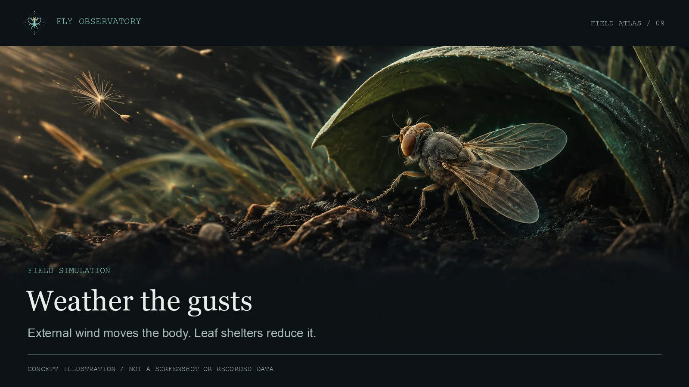 |
| **Midnight porch** | **One shared controller** |
| 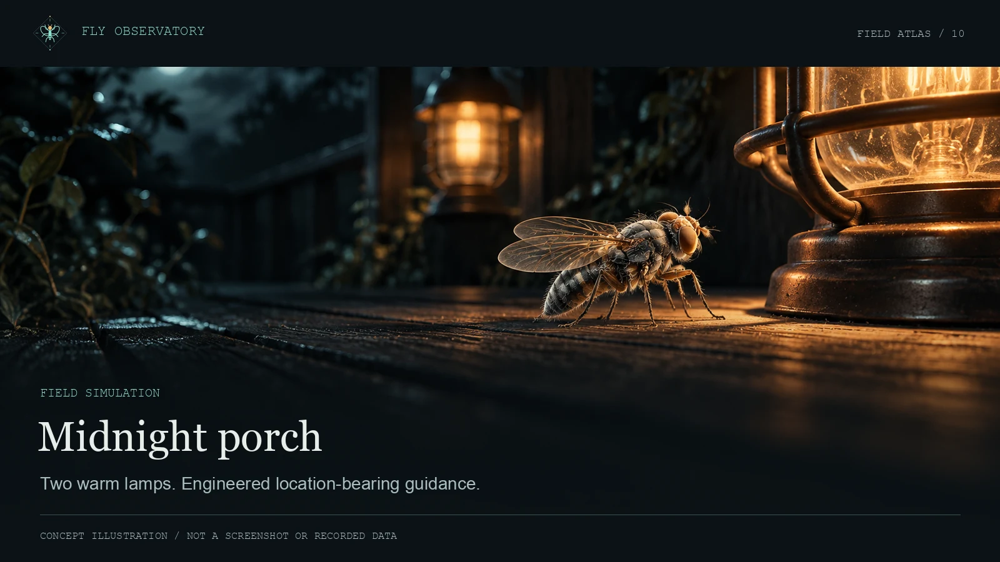 | Every field world uses the same frozen reservoir and trained decoder. The cues, physical rules, and game objectives are engineered, not claims of innate behavior. |

| World | What happens |
| --- | --- |
| Windfall orchard | Visit four fallen-fruit patches, with proximity/dwell-based rewards. |
| Follow the scent | Track a pulsing, drifting odor field using local concentration gradients and an upwind cue, not the food's direction. |
| Spider escape | A scripted spider pursues the body; count measured danger-zone exits and close contacts. |
| Dangerous picnic | Food cues switch to escape cues when a moving swatter approaches. |
| Between the stones | Preselected route waypoints and short-range obstacle cues guide the controller; solid rocks physically block the body. |
| Weather the gusts | External wind displaces the body; leaf shelters reduce that force. |
| Midnight porch | Visit two warm lamps against a moonlit wooden backdrop. |

Each scene has a seeded starting body, an objective, event notices, and a game
score. Patch visits require 0.4 numerical seconds within 0.9 world units. Rewards
are based on measured body positions, never scheduled successes. Completed
single-source objectives cannot be repeatedly farmed for points. The cyan ring
marks an **engineered guidance cue**, not something the biological fly sees.
The score is an engineered game rule, not biological fitness or intelligence.

These are **real-world-inspired simulations**, not a real-world deployment or
validated models of fly behavior. Food bearings, threat detection, obstacle
repulsion, route waypoints, odor gradients, and search casting are engineered
adapters. They supply a desired bearing to the same frozen reservoir and trained decoder.
They do not directly set heading. Wind and collision forces change position
only; body mesh, particle effects, predator motion, and scenery are illustrative.
No retinal vision, authentic olfaction, natural foraging, predator recognition,
or learning is claimed. Neural population telemetry still comes from the actual
signed-connectome simulation.

Scene layout and collision geometry share `scenarios.json`. Runtime sensors,
physics, and event counting live in `scenarios.py`; `src/worlds.js` builds the
illustrative surroundings. Manual light/task controls return to laboratory
rules; brain-off and pause also work inside field scenarios.

## Scientific boundaries

The old viewer is `~/fly-brain/drugs/index.html`. It used 700-neuron synthetic
networks and stylized coordinates. This is a separate project; it does not modify
the older work.

This exhibit uses a **simplified LIF reservoir**, not the Shiu electrophysiology
implementation used in the racing project. Signed weights are normalized by each
cell's total absolute incoming weight. Voltage decay is 0.8, tonic drive 0.14,
recurrent gain 1.2, threshold 1.0, and numerical step 20 ms.

Bearing and angular velocity are encoded through fixed seeded ±1 weights into
actual cells that connect to descending neurons, with an added 0.08 background
drive at those relay cells. Descending spike traces (decay 0.7 per step) feed a
ridge decoder trained to match an engineered proportional-damping teacher.
The reservoir is not trained. The decoder is. This is not retinal pixel vision
or a claim of innate fly phototaxis, intelligence, consciousness, or learning.

The decoder uses separate training, penalty-selection, and independent test
signal sequences (2,100 training samples, 650 each for penalty selection and test).
Its displayed R² measures task-signal decoding, **not** behavior
success or a biological-wiring advantage. A failing decoder stops the exhibit.

Body mesh, gait, speed, target movement, and boundary collisions are engineered.
Neural output alone changes heading. Coordinates are uniformly scaled and axis
rotated, preserving recorded relative geometry, including the ventral cord.
The viewer displays 16,000 sampled real neuron locations, not every cell.
Activity bars are population-mean Hz with a fixed 0–50 Hz scale. Bright points
represent measured sampled spikes with a short visual fade.

The brain-off toggle tests dependence on neural output. Proving a connectome
advantage requires shuffled wiring and direct-controller controls across matched
seeds, activity levels, and independently trained decoders. No such claim is made.
Wall-clock playback may be slower than the reservoir's numerical clock.

## Development and checks

```sh
npm run build
npm test
FLY_PYTHON="${FLY_PYTHON:-$HOME/jevlike/.venv/bin/python}"
"$FLY_PYTHON" -m unittest discover -s tests -v
```

Run `npm run dev` for the Vite frontend with `/api` proxied to the backend at 8932.
FastAPI serves the production build at the same origin. One owner thread steps the
brain; HTTP and SSE readers never step it. Closing the server stops that clock.
Google Fonts are optional typography requests; rendering and runtime assets are
local and continue to work without them.

For manual mode from startup: `FLY_BROADCAST=0 sh run.sh`.
The shared program is defined in `broadcast-program.json`; frontend captions
and the server director use that same file.

Optional real-network integration check (about 5–7 minutes):

```sh
~/jevlike/.venv/bin/python tests/live_broadcast.py
```

This **resets the shared exhibit**. Run it before broadcasting, not during a live
audience session. It checks all sixteen chapters, repetition, three target changes,
measured seek/evade behavior, and matched brain-off/on trials. Results are saved
to `artifacts/broadcast-check.json`.

For a shorter real-network check of all seven worlds, pause, brain-off, and
input validation: `~/jevlike/.venv/bin/python tests/live_scenarios.py`.
It changes the shared scenario and restores automatic playback afterward.
Do not run the two integration checks simultaneously or during a live audience
session.

## Visual identity

The [brand kit](docs/brand/README.md) includes the
[SVG fly mark](docs/assets/logo.svg), an
[editable infographic](docs/assets/signal-flow.svg), and a
[1200 × 630 social card](docs/assets/social-card.png).
The [showcase manifest](docs/brand/showcase.json) describes all ten
[concept illustrations](docs/assets/showcase/).
All README images are local files; no image-hosting service is required.
